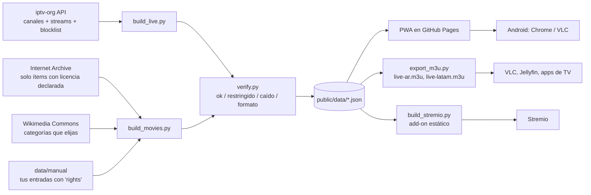

# Mi Plataforma — IPTV y cine libre, personal y gratuito

App web instalable (PWA) con tres secciones: **Live**, **Movies** y **Series**. Se administra desde el celular: un robot de GitHub Actions actualiza el catálogo una vez por semana y publica la app en GitHub Pages. No necesitás PC para el uso diario.

> **Lo más importante, antes de seguir**
> - La app **no aloja ni retransmite video**. Muestra enlaces públicos y el **estado** de cada uno.
> - **No pude probar ningún enlace real** (mi entorno no tenía internet). Las listas M3U y los catálogos reales **no vienen en el ZIP: se generan solos en tu primera corrida en GitHub.** El código está probado con 49 pruebas locales. Ver `docs/RESUMEN_PRUEBAS.md`.
> - Los datos de `data/fixtures` (`ejemplo.invalid`) son solo de prueba y el workflow los borra antes de construir.
> - Películas incluidas a mano: 4 películas abiertas de Blender (licencia Creative Commons) y 2 enlaces a plataformas oficiales gratuitas. Ninguna fue abierta por mí; el verificador las comprueba en tu primera corrida.

## Qué hace cada parte



- **Metadatos ≠ reproducción.** Cada ítem separa título/carátula/sinopsis de sus `sources` (URL real + estado). Si solo hay metadatos, no se muestra como disponible.
- **Estados:** Funciona · Acceso restringido (401/403/451, posible geobloqueo) · Caído · Formato no compatible · Sin verificar · Dato de prueba. Además se avisa “HTTP sin cifrar” y “Exige cabeceras propias”: en esos casos el navegador no puede reproducir y se ofrece **Abrir en VLC**.
- **Derechos:** se excluyen canales `is_nsfw`, cerrados y los de la *blocklist* de iptv-org (incluye pedidos DMCA). Las películas de Internet Archive entran solo si tienen `licenseurl`. Opcional: `data/manual/live_allowlist.txt` para mostrar **solo** los canales que vos elijas.

## Instalación desde Android (sin PC) — resumen

Guía completa con todos los detalles: **`docs/INSTALACION_ANDROID.md`**. Si algo falla: **`docs/SOLUCION_ERRORES.md`**.

Método: subís **un ZIP sin descomprimir** y **pegás un archivo de texto** en la ruta `.github/workflows/update.yml`. El robot de GitHub instala todo solo. (Chrome en Android no sube carpetas, y así no se pierde la carpeta oculta `.github`.)

1. Creá una cuenta en github.com y un repositorio **Public** llamado `mi-plataforma` (con README).
2. **Add file → Upload files** → elegí `mi-plataforma.zip` desde Descargas → **Commit changes**.
3. **Add file → Create new file** → nombre `.github/workflows/update.yml` → pegá el contenido de `PEGAR_EN_GITHUB_update.yml.txt` → **Commit changes**.
4. **Settings → Pages → Source: GitHub Actions**.
5. **Actions → Actualizar catálogo y publicar → Run workflow**. Esperá el tilde verde.
6. Tu app queda en `https://TU-USUARIO.github.io/mi-plataforma/`. En Chrome: ⋮ → **Instalar app**.
7. Listas M3U: `…/lists/live-ar.m3u` y `…/lists/live-latam.m3u`. Add-on de Stremio: `…/stremio/manifest.json`.

## Configuración de GitHub Pages y GitHub Actions

- **Pages:** *Settings → Pages → Source → GitHub Actions*. Se publica **solo la carpeta `public/`**. Es **público** (cualquiera con la dirección lo ve), aunque no aloja video.
- **Actions:** el workflow corre **cada lunes 07:00 UTC** y cuando tocás *Run workflow*. Pasos: instalar desde el ZIP (solo la primera vez) → limpiar datos de prueba → pruebas → canales → películas (si falla, sigue) → verificar enlaces (un enlace roto no frena el resto) → **guardias** → M3U y Stremio → publicar.
- **Guardias:** si el resultado es sospechoso (API vacía, sin canales argentinos, caída de red del servidor, listas M3U vacías por error), la corrida **falla y no publica**: queda en línea la versión anterior.
- **Puede pausarse o fallar:** GitHub desactiva los workflows programados tras 60 días sin actividad en repositorios públicos. Si el sitio no se actualiza, tocá *Run workflow*.
- **Permisos:** si ves “Resource not accessible by integration”: *Settings → Actions → General → Workflow permissions → Read and write*.

## Qué se publica y qué queda en el repositorio

| Se publica (`public/`) | Queda solo en el repositorio |
|---|---|
| La app, `data/*.json` (catálogos e informe), `lists/*.m3u`, `stremio/*` | `tools/`, `data/` (manuales, historial), `docs/`, `tests/`, `config.json` |

No hay claves ni datos privados. La clave de TMDB (opcional) se guarda solo en tu celular.

## Personalizar

- `config.json`: consultas de Internet Archive y categorías de Commons.
- `data/manual/movies.json` / `series.json`: tus propias entradas (obligatorio el campo `rights`). Ver `data/manual/EJEMPLO.md`.
- `data/manual/live_allowlist.txt`: modo conservador de canales.
- TMDB (opcional): en **Ajustes** pegás tu clave gratuita; se guarda solo en el teléfono (no en el repositorio).

## Probar en local (opcional, requiere PC o Termux)

```
python -m unittest discover -s tests -v       # 49 pruebas, sin internet
python tools/build_live.py --fixtures data/fixtures/api
python tools/build_movies.py --fixtures data/fixtures
python -m http.server 8000 --directory public
```

## Estructura

```
tools/    importadores, verificador, guardias, exportadores (Python, sin dependencias)
public/   la app (PWA) + data/ + lists/ + stremio/ (se publica en Pages)
data/     fixtures de prueba, entradas manuales, historial de verificación
tests/    pruebas con servidor HTTP local
docs/     instalación Android, solución de errores, resumen de pruebas, investigación, costos, limitaciones
```

## Pendientes antes de usarla en serio

- Agregar el **logo oficial de TMDB** en Ajustes si vas a usar TMDB (lo exigen sus condiciones).
- Revisar las consultas de `config.json` en la primera ejecución: pueden devolver 0 resultados (la app y el informe lo avisan).
- `hls.js` se carga desde cdnjs, versión 1.5.20 (listada en cdnjs.com).
